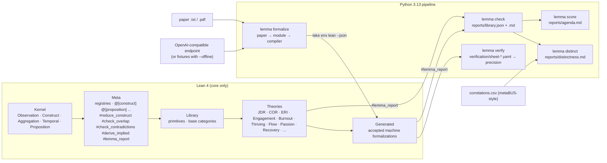

# Lemma

A type system for organizational constructs and propositions, built on Lean 4, with an AI pipeline that formalizes papers into the type system and a scorer that ranks typed propositions by how badly they need empirical verification.

Sumer Vaid, Harvard Business School. Apache-2.0. Research prototype accompanying the Stage 1 proposal to the *Organization Science* special issue on AI-Enabled Frontiers in Organizational Science.

## What Lemma is

Taste depends on reading the state of a field. In organizational science the state of the field is close to unreadable. Management journals sustain hundreds of named constructs and dozens of named theories, each with a scale, a literature, and a vocabulary. Engagement, thriving, vigor, flow, and passion overlap in ways each literature acknowledges and leaves unresolved. Job demands-resources theory, conservation of resources theory, and the effort-reward imbalance model make partly identical and partly competing claims about strain in three separate vocabularies. A construct exists as a paragraph, a proposition as a sentence with a direction, a theory as a paper. Relations among theories live in review articles, which compare two or three theories at a time and become stale on publication.

Lemma treats the question as a representation question. A small kernel specifies construction rules with zero psychological content. Every construct and every proposition is a library definition which must reduce to the kernel. A compiler then answers, with zero new data, whether a new construct duplicates an existing one, whether a proposition declares the level and horizon at which the proposition applies, and whether two theories compiled as typed modules compose or contradict each other. Types make these checks decidable. A Mathlib-style library makes formalizations compose across theories. Open-weight language models remove the hand-formalization cost. The research loop then reads the compiled library as a map of where theory rests on thin evidence, where theories depend on one another, and where theories contradict one another, and proposes tests in that order.

## Pilot numbers

Generated by `make report` from `reports/library.json`. Do not edit by hand.

<!-- BEGIN GENERATED NUMBERS -->
| Quantity | Value |
|---|---|
| Kernel version | 0.1.0 |
| Theories (modules) | 21 (15 curated, 6 accepted from the pipeline) |
| Primitives | 18 |
| Constructs | 73 (53 curated, 20 accepted from the pipeline) |
| Propositions | 89 (73 curated, 16 accepted from the pipeline) |
| Source papers | 67 (67 curated sources, 6 accepted pipeline papers) |
| Overlap warnings | 164 (54 within the curated library, 54 of them resolved by declaration; 110 raised against accepted pipeline modules) |
| Cross-theory contradictions | 1 |
| Conditional disagreements | 1 |
| Shape disagreements | 1 |
| Implied, untested propositions | 85 |
| Formalization failures | 3 of 9 pipeline papers |
| Verified precision | not yet available (no labelled review sheets) |
<!-- END GENERATED NUMBERS -->

Breakdown and tables: `reports/library.md`, `reports/agenda.md`, `reports/distinctness.md`.

## Architecture



## Quickstart

Requirements: Lean 4.15.0 (the `lean-toolchain` file pins it; the CI workflow shows the tarball install), Python 3.11 or later.

```bash
git clone https://github.com/sumervaid/lemma && cd lemma
make install          # pip install -e pipeline[dev]
make build            # lake build: kernel, library, theories, accepted generated modules
make test             # lake build LemmaTests (#guard_msgs) + pytest + ruff
make report           # offline pipeline end to end, regenerates reports/ and the numbers above
```

The compiler checks run when a theory file is elaborated. Build output for the pilot contains warnings of the form

```
warning: Lemma/Theories/Thriving.lean:40:2: shares primitive Energy with Engagement.vigor
  Thriving ∋ Vitality.energy ~ Engagement.vigor : Energy at Individual / Weekly
  overlap kind: partial (1 of 2 primitive(s) of Thriving, 1 of 3 of Engagement)
  resolve with: declare_overlap Thriving distinct_from Engagement "reason" (or alias_of / subtype_of)
```

To run the pipeline with a live model instead of fixtures, point `LEMMA_LLM_BASE_URL` and `LEMMA_LLM_MODEL` at any OpenAI-compatible endpoint (see `.env.example`) and run `lemma formalize fixtures/papers/*.txt --max-repairs 1`.

## How to add a construct or a theory

One theory per module under `Lemma/Theories/`, one construct per definition, a citation docstring on every definition, and an overlap declaration for every overlap the compiler reports. `CONTRIBUTING.md` has the checklist.

```lean
import Lemma.Theories.Engagement

namespace Lemma.Theories.MyTheory

/-- Vitality: the positive feeling of having energy available (Spreitzer et al. 2005, p. 539). -/
@[construct] structure Vitality extends AffectiveState (level := .Individual) (horizon := .Weekly) where
  energy : Energy

-- warning: shares primitive Energy with Engagement.vigor ...

declare_overlap Vitality distinct_from Engagement.Vigor
  "Vitality is the affective energy component of thriving; Porath et al. 2012 report discriminant validity"

/-- Vitality predicts task performance (Author Year). -/
@[proposition] def vitality_performance : Proposition Vitality Engagement.TaskPerformance :=
  { direction := .Positive, level := .Individual, horizon := .Weekly,
    evidence := .CrossSectional, citation := "Author Year, Journal Vol, pages" }

end Lemma.Theories.MyTheory
```

Primitives live in `Lemma/Library/Primitives.lean`. Adding one is a reviewed change to the vocabulary, documented in `CHANGELOG.md`.

## The four checks

All four run inside Lean, at elaboration time through attributes and on demand through commands. `ARCHITECTURE.md` gives the semantics.

| Check | Question | Where it runs | Outcome |
|---|---|---|---|
| Q1 Reduction | Does the construct unfold to registered primitives, each inside a `Construct level horizon` scope? | `@[construct]`, `#reduce_construct` | Error (no `IsConstruct` instance is generated, so the construct cannot enter a proposition) |
| Q2 Overlap | Which registered constructs share a primitive at the same scope? Identity, subtype (leaf-set inclusion) or partial. | `@[construct]`, `#check_overlap` | Warning per overlapping construct until a `declare_overlap A distinct_from/alias_of/subtype_of B "reason"` is recorded |
| Q3 Scope | Do both constructs live at the proposition's declared level and horizon, or route there through a registered `@[aggregation]` or `@[temporal]` rule? | `@[proposition]`, `#check_scope` | Error on mismatch, info on routing. The kernel rejects rules that lower a level or shorten a horizon by `decide` |
| Q4 Composition | Do two theories contradict (same pair, scope and boundary, contradicting direction)? What do unconditional chains `A → B → C` imply, and is the implication tested? | `@[proposition]`, `#check_contradictions`, `#derive_implied` | Warning across theories, error within one theory, list of implied candidates with status |

## How the scorer works

`lemma score` ranks every registered proposition and every implied-untested candidate:

```
score(p) = 0.40·E(p) + 0.25·S(p) + 0.25·G(p) + 0.10·I(p)
```

`E` maps the strongest evidence kind attached to the claim across all theories stating it to `[0, 1]` (meta-analytic 0.1 ... none 1.0). `S` is structural load, `min(1, (theories asserting + implied propositions depending) / 8)`. `G` is the strongest disagreement the claim takes part in (contradiction 1.0, implied contradiction 0.8, conditional 0.6, shape 0.5). `I` is 1 for a claim no theory states but two propositions jointly imply. Weights and tables are in `config/scoring.yaml`, the function in `pipeline/lemma/score.py`, the tests in `pipeline/tests/test_score.py`. The agenda is `reports/agenda.md`.

## Reproducibility

Every artifact under `reports/` is regenerated by `make report` from checked-in sources: the Lean library, the fixture papers and formalizations under `fixtures/`, the correlation CSV, and `config/scoring.yaml`. The Lean report (`#lemma_report`) is a dump of persistent environment extensions, so the same library produces the same JSON. Nothing in the test suite touches the network. The numbers in this README are written by the pipeline, not typed.

## Limitations, stated plainly

- **No live model run.** The container used to build the pilot has no GPU and no model endpoint. Every machine-formalization artifact in this repository was produced with `--offline`, from hand-written fixtures in `fixtures/formalizations/` written by the author in the format a model is asked to return. They exercise every pipeline outcome (accepted with overlap warnings, reduction failure, scope failure, declined). They say nothing about a model's precision. `reports/precision.json` reports precision as unavailable until a reviewer labels a sheet produced from a live run.
- **Pilot scale.** One domain, fifteen curated theory modules, a few dozen constructs. The theory tag of a proposition is its module, and the curated modules are the author's readings of the cited papers. Fidelity of each docstring to its source is itself a verification task.
- **The kernel is a methodological commitment.** Observations are measurement events, constructs are functions from observations to primitive values, and the primitive vocabulary encodes a position. The kernel is versioned (`KERNEL_VERSION` in `Lemma/Kernel/Basic.lean`, history in `CHANGELOG.md`), and kernel revisions are reviewed contributions.
- **Cross-level propositions** are stated at the higher level over an aggregate of the lower-level construct. Top-down (contextual) effects as such have no kernel rule yet, and the pipeline records one such paper as a formalization failure for this reason.
- **Composition is length-2 and path-signed.** An implied `A → C` is the sign of one mediating path, not a total effect, and `Null` links do not compose.
- **Empirical distinctness** uses a small CSV with illustrative and recalled correlations, every row labelled as such. No value has been checked against metaBUS.

## Layout

```
Lemma/Kernel/        five construction rules, zero psychological content
Lemma/Meta/          registries, checks, attributes, commands
Lemma/Library/       primitives and base categories
Lemma/Theories/      pilot library, one module per theory
Lemma/Generated/     accepted machine formalizations (pipeline output)
LemmaTests/          #guard_msgs tests pinning compiler messages
pipeline/            Python package `lemma` (formalize, check, score, distinct, verify)
fixtures/            paper summaries, fixture formalizations, correlations.csv
bibliography/        curated source list counted by `lemma check`
config/scoring.yaml  scorer weights
reports/             generated reports (library, agenda, distinctness, papers, failed modules)
verification/        human review sheets and precision
scripts/report.lean  the Lean script that dumps the registries
```
